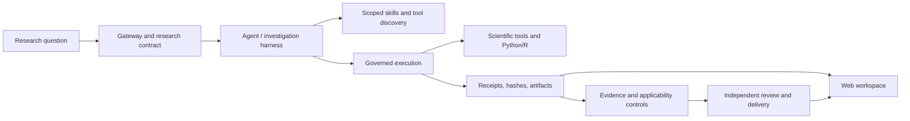

# BioMA-Peptide

**Evidence-grounded autonomous execution for dry-lab peptide research.**

[中文说明](README_zh.md)

BioMA-Peptide is a clean, peptide-oriented continuation of BioMA. It preserves the
production agent runtime, governed scientific execution, provenance and evidence
controls, Web workspace, featured cases, scientific tools, and a curated skill
catalog. Historical evaluation runs, experiment snapshots, generated artifacts,
logs, and legacy project documents are intentionally excluded.

## Motivation

Peptide computation is more than generating a sequence or calling a predictor. A
useful research agent must keep exact sequence and structure identities, distinguish
predictions from measurements, bind downstream work to the result that was actually
used, preserve execution receipts, and revise only the conclusions affected by new
conditions. BioMA-Peptide provides that execution and evidence boundary while leaving
scientific choices to the agent and researchers.

The project is intended for computational research such as peptide sequence analysis,
structure prediction workflows, docking, developability assessment, literature and
public-resource retrieval, reproducible Python/R analysis, and report generation.
It does **not** replace wet-lab validation, clinical review, or domain expert judgment.

## Core Capabilities

- **Governed agent loop** — budgeted model/tool actions, checkpoints, recovery, and
  explicit completion contracts.
- **Real execution** — isolated Python/R and shell-backed analysis with declared
  inputs, outputs, time limits, and retained artifacts.
- **Scientific grounding** — typed work results, exact dependency references,
  applicability checks, claim/evidence relations, and independent delivery review.
- **Traceability** — append-only ledger events, hashes, receipts, artifact versions,
  source identity, and replayable scientific state.
- **Peptide toolchain** — sequence and structure utilities, cyclic/cross-linked peptide
  structure support, permeability/developability helpers, docking-related tools, and
  approved public scientific resources.
- **Curated skills** — 126 peptide/protein, structure, docking, literature, reporting,
  and visualization skill packages. Skills guide decisions but never grant themselves
  execution authority.
- **Web workspace** — live run status, conversation history, evidence and provenance
  views, artifact previews, reports, plots, sequence views, and interactive structures.

## Architecture



The model chooses the scientific action, method, and result to reuse. The runtime
checks permissions and action facts, binds execution to real inputs and outputs, and
prevents an unverified result from silently acquiring scientific authority.

## Quick Start

Requirements: Python 3.10+; Python 3.12 is used in CI.

```bash
git clone https://github.com/YuyangSunshine/bioma-peptide.git
cd bioma-peptide
python -m venv .venv
source .venv/bin/activate
python -m pip install --upgrade pip
python -m pip install -e ".[dev,prediction,analysis]"
cp .env.example .env
```

For a deterministic local Web smoke test that requires no model credential:

```bash
bioma-peptide-web --toy --host 127.0.0.1 --port 8014
```

Open `http://127.0.0.1:8014`. For model-backed runs, set `CHATEXCEL_API_KEY` in a
private environment file and start:

```bash
bioma-peptide-web --config configs/bioma.yaml --env-file .env
```

The checked-in configuration uses an OpenAI-compatible endpoint. Credentials are
read from environment variables and must never be committed. Optional local
AlphaFold/ColabFold and protocols.io settings are documented in `.env.example`.

## Featured Web Cases

The homepage retains six BioMA examples to demonstrate the artifact and evidence UI:

1. DESeq2 analysis of MASH liver tissue.
2. CellChat cell-cell communication analysis.
3. B2M AlphaFold2 structure with interactive 3D viewing.
4. Gastric-cancer single-cell dataset discovery and metadata preview.
5. Glioblastoma GRN and transcription-factor activity report.
6. Human left-ventricle/T2D co-expression network report.

These are presentation and workflow examples, not bundled claims of reproducibility.
A new run still requires the stated data, dependencies, permissions, and compute.

## Project Layout

```text
bioma-peptide/
├── src/bioma/             # API, runtime, harness, evidence, Web server and UI
│   ├── core/              # scientific contracts, states, relations and models
│   ├── runtime/           # admission, execution, ledger, receipts and controls
│   ├── harness/           # investigation loop, code execution and review
│   ├── backends/          # scientific and analysis backends
│   ├── skills/            # skill discovery and scoped loading
│   └── static/            # Web workspace and featured-case catalog
├── tools/                 # governed scientific tool implementations
├── skills/                # curated peptide/protein scientific skills
├── configs/               # runtime configuration
├── devices/               # optional device capability manifest
├── examples/              # deterministic API and protocol examples
├── tests/                 # focused production regression tests
└── scripts/               # core CI gate
```

Not migrated: `evaluation/`, `experiments/`, historical `docs/`, generated
`artifacts/`, run databases, result snapshots, caches, or logs.

## Development

```bash
python -m pytest -q
scripts/run_core_runtime_gate.sh
python examples/claim_evidence_demo.py
```

Before adding a peptide method, define its accepted inputs, result contract,
limitations, required tools, verification obligations, and artifact outputs. Do not
encode a case-specific correct answer in the runtime. A skill or model statement is
not evidence until a permitted execution and applicable verification support it.

## Scientific and Safety Boundaries

- Predictions and database annotations remain computational evidence, not experimental
  confirmation.
- A successful tool call does not by itself establish scientific applicability.
- Public-resource access remains allowlisted and bounded; arbitrary network or package
  installation is not enabled inside scientific execution.
- Historical artifacts are immutable. Reuse, regeneration, and recomputation must be
  represented as new, traceable actions.
- Third-party skill packages retain their own attribution and license files. Review
  those terms before redistribution or commercial use.

