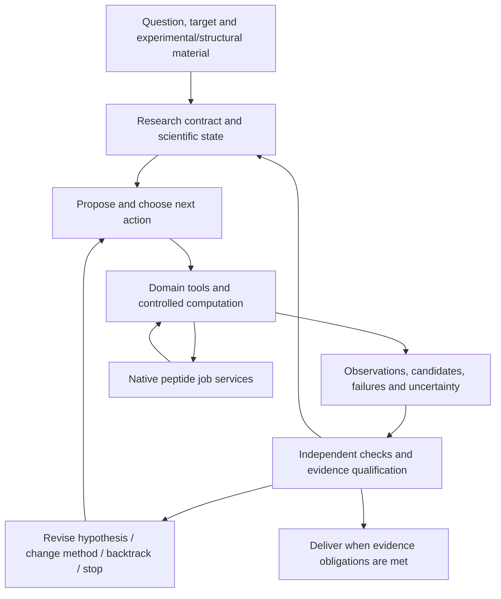

# BioMA-Peptide

**An autonomous scientific agent for peptides, macrocycles and bicycles: domain-aware action selection and independent evidence validation.**

[中文说明](README_zh.md) · [Native computation API](docs/peptide/README.md) · [Validation record](docs/peptide/MIGRATION_VALIDATION.md)

> Status: peptide computation is integrated into the native BioMA package; autonomous research and verification remain available, with targeted regression tests and limited real computation. The complete Nectin-4 workflow and production MD have not passed acceptance. Merging code does not grant scientific approval.

## Scientific motivation

### From executing tools to resolving scientific uncertainty

A scientific agent can write valid code or run a docking tool without establishing that the result answers the research question. ScienceAgentBench evaluates generated programs and scientific task outcomes separately and documents limits to end-to-end research automation. It is not a peptide benchmark; it motivates the distinction this project studies: **did an action reduce the relevant scientific uncertainty?** [ScienceAgentBench](https://arxiv.org/abs/2410.05080)

Peptide research requires decisions about expanding conformational search, repairing a receptor, checking parameters, rejecting a candidate or revising a binding hypothesis. A sequence of successful process exits cannot make those decisions. BioMA-Peptide grounds BioMA's autonomous research and verification capabilities in peptide chemistry. Superiority over general scientific agents remains a research question, not an established benchmark claim.

### Why peptides, macrocycles and bicycles

Peptides offer a design space for protein-surface recognition and modulation of protein interactions, but affinity, selectivity, stability and developability must be considered together. Cyclization restricts conformation without automatically solving those trade-offs. Experimental work on orally available cyclic peptides combined activity, stability and permeability optimization. [Merz et al.](https://www.nature.com/articles/s41589-023-01496-y)

A cyclic peptide is not simply a small linear protein with joined ends. Cyclic topology requires explicit treatment: work adapting AlphaFold2 to cyclic peptide prediction/design illustrates why protein prediction cannot be assumed to transfer unchanged. [Cyclic peptide structure prediction and design](https://www.nature.com/articles/s41467-025-59940-7)

Bicyclic peptides introduce coupled ring constraints and linker chemistry. In this project's TBMB systems, sequence alone does not specify the crosslink graph, charge or stereochemical state. We therefore treat conformer selection, chemical validity, receptor-state suitability and parameter applicability as scientific decisions rather than consequences of a docking score.

### Target context: the evidenced Nectin-4 case

9KKJ comes from a Nectin-4–antibody structural study, not an experimental complex of this project's bicyclic peptide. Selecting a domain, handling complex components and proposing a peptide binding mode are separate reasoning steps. [Original structural study](https://www.jbc.org/article/S0021-9258%2825%2902668-7/fulltext)

The local case adds missing-region repair, construct boundaries, parameter-use review and candidate stereochemical consistency. These challenge an agent to detect contradictions and stop invalid evidence propagation, not merely launch longer simulations. Nectin-4 is currently the only target with verified project materials described here; additional targets require evidence before being represented as supported or validated cases.

## Design and contributions

**Autonomously choose research actions; independently qualify their evidence.** BioMA's task interpretation, action generation, scientific control, revision and delivery review remain in the project. Native peptide services supply domain methods and long-running computation, not a replacement fixed pipeline.

- **Question- and evidence-driven actions:** `BioMA`, `scientific_control` and the `harness` tool loop support research decisions. Behavior is configuration-dependent; `adaptive_v3` is explicitly selected, not automatically enabled by default.
- **Chemistry-aware checks:** preserve sequence, crosslinks, charge, stereochemistry and parameter identity; unknown or failed results cannot gain scientific credit through a narrative summary.
- **Separate generation and verification:** artifact checks, fixed scientific validators and delivery review serve distinct purposes. An Agent's explanation cannot replace structural or parameter validation.
- **Long calculations as manageable actions:** persistent job identity, cancellation, resume, budgets and external artifacts are native services. They do not prescribe the next scientific action.
- **Separate experimental and computational evidence:** enrichment, Kd, functional measurements, predictions, docking and MD retain different meanings. Missing observations are not valid negatives.

This combines research control with domain constraints, not a new force field or docking algorithm. End-to-end autonomous design, cross-target generalization and comparative benefits remain to be evaluated.

## Architecture: an autonomous research loop



Computations have prerequisites: MD needs valid topology and applicable parameters. Such dependencies do not fix research decisions. The Agent can inspect experiments first, select a different conformer method, reject a candidate or revisit receptor preparation. Existing decision/revision regressions are controlled tests, not proof of autonomous discovery on every real target.

### Removing the migration bridge

The separate `bridge/` distribution originally avoided collisions between two BioMA packages during migration. The domain code now belongs to this repository, so the extra installation and synthetic `bioma` module loader have been removed. Computation lives in `src/bioma/peptide/`, tests in `tests/peptide/` and contracts in `docs/peptide/`. Lazy top-level imports let scientific workers use the native package without initializing the research runtime or models. Detached processes remain because long scientific jobs and Agent sessions have different lifetimes; they are an execution boundary, not another bridge product.

Public `BioMA.run/query` retains its existing research controller. A previously tested OpenHands controller belongs to a separate private project and is not claimed as integrated here. No nested OpenHands/legacy decision loop is introduced. Uniform Agent exposure and scientific validators for all added MD methods remain incomplete. Some resource limits are sampled; the cooperative GPU lease is neither hard VRAM partitioning nor a general scheduler.

## Available computational stages and dependencies

| Stage | Method | Outputs and constraints |
|---|---|---|
| 0. Register task/data | Target/domain, chemical state, sources, replicate relationships, use profile | Case-specific charge and receptor-retention policies must be explicit |
| 1. Build topology | `build_crosslinked_peptide_topology` from a chemical spec | Authoritative graph, chemical identity and stage manifest |
| 2. Generate conformers | RDKit ensemble or Boltz prediction path | Candidates and software/model versions; external dependencies remain required |
| 3. Optimize/select/export | xTB optimization, topology/structure checks and clustering | Configuration hash, checkpoint and partial/interrupted semantics; no cross-configuration checkpoint reuse |
| 4. Prepare receptor/pockets | Profile-controlled receptor preparation and P2Rank | Retention/repair audit; pockets are model hypotheses |
| 5. Dock | Global DiffDock, chemical/geometric filtering, pocket assignment | Candidate evidence and explicit rejection reasons |
| 6. Parameterize/relax | Reviewed TBMB-Met RESP templates/bonded terms; ff14SB/TLEaP assembly and restrained OpenMM relaxation | Sequence-specific topology/coordinates and parameter hashes; no approximate-parameter fallback |
| 7. Rescore | Vina score-only/local-only on relaxed poses | Linked computational scores, not experimental Kd |
| 8. Prepare/run MD | Stage A → build → minimize → NVT/NPT equilibrate → segmented production | Source is migrated; real case use review and complete GPU broker qualification remain pending |
| 9. Aggregate | Independently checked candidates, artifact references and separate measurements | Docking/MD evidence is not affinity; end-to-end MM/GBSA was not qualified in this migration |

Parameter qualification is a prerequisite for the computation that consumes it, regardless of table order. RDKit, Boltz and xTB paths are selected for the task; not every workflow must execute every branch.

## Core skills and tool exposure

- [crosslinked-peptide-structure](skills/model_capabilities/our-skills/sk.8c792d469d40b961/crosslinked-peptide-structure/SKILL.md): chemical spec, topology, conformers, xTB, validation/selection/export, with schema, stopping rules and stage-artifact references.
- [tbmb-bicyclic-peptide-docking](skills/model_capabilities/our-skills/sk.4fbe227040e54d55/tbmb-bicyclic-peptide-docking/SKILL.md): parameter packaging, receptor preparation, P2Rank, DiffDock, OpenMM relaxation and local Vina rescoring. It explicitly ends before MD; current +5/TBMB assumptions apply only to matching profiles.

Skills guide procedures; they are neither execution permissions nor scientific validators. The native peptide module explicitly registers six structure tools plus `prepare_receptor`, `detect_pockets`, `diffdock_screen` and `vina_refine`. The six structure tools are topology building, RDKit and Boltz conformer generation, xTB optimization, conformer validation/clustering/selection, and ensemble export. Run `catalog` for exact names and schemas.

`parameterize_tbmb_scaffold` and `relax_complexes` source/skill support exists but is not automatically added to that ten-tool execution allowlist. `tbmb_md_production` is a separately gated method; other MD modules are not all exposed as uniform Agent actions.

## Directory tree

Main paths only; inherited auxiliary modules and non-core skills are omitted.

```text
bioma-peptide/
├── src/bioma/
│   ├── api.py                      # BioMA: research task and query entry
│   ├── scientific_control/         # Evidence-driven options, selection, revision
│   ├── harness/                    # Autonomous tool loop and delivery review
│   ├── core/                       # Scientific state, evidence, verification
│   ├── runtime/                    # Admission, ledger, budgets and provenance
│   ├── peptide/                    # Native peptide computation services
│   │   ├── broker.py / worker.py    # Persistent controlled jobs
│   │   ├── domain.py / catalog.py   # Pinned domain execution / tool inventory
│   │   ├── contracts.py            # Result identity and separate status layers
│   │   ├── admission.py            # Production-use admission
│   │   ├── validators.py / data.py  # Chemical checks and measurement semantics
│   │   └── cli.py                  # Native bioma-peptide CLI
│   └── web.py                      # Existing research UI
├── tools/our_tools/
│   ├── crosslinked_peptide_structure.py
│   ├── _crosslinked_impl/          # Topology, conformers, xTB, export
│   ├── tbmb_bicyclic_docking.py
│   ├── tbmb_parameter_source.py
│   └── tbmb_md_*.py                # Preparation, build, minimization, MD
├── skills/model_capabilities/our-skills/
│   ├── sk.8c792d469d40b961/crosslinked-peptide-structure/
│   └── sk.4fbe227040e54d55/tbmb-bicyclic-peptide-docking/
├── skills/_meta/                  # Stable skill registry
├── tests/peptide/                 # Domain/job tests and stage regressions
├── tests/test_scientific_*.py      # Research decision and revision tests
├── docs/peptide/                  # Execution contract and migration provenance
├── configs/                       # Model, research and tool configuration
├── examples/
├── scripts/
├── devices/
├── pyproject.toml                 # One distribution: bioma-peptide
├── README.md
└── README_zh.md
```

## Development and validation quick start

### Install the single project package

Use Linux, Python ≥3.11, `/proc`, POSIX locks and local SQLite. Root `pyproject.toml` defines the project dependencies; there is no separate bridge installation. Do not install two distributions providing `bioma` in the same environment.

```bash
git clone https://github.com/YuyangSunshine/bioma-peptide.git
cd bioma-peptide
python3.11 -m venv .venv
source .venv/bin/activate
python -m pip install -e .
bioma-peptide --help
bioma-peptide catalog --source-root "$PWD"
```

`catalog` inspects source schemas/versions/classification; visibility does not establish installed dependencies or production authorization. This does not install OpenHands, model weights, OpenMM, AmberTools, xTB, P2Rank, DiffDock or Vina.

### Run migration regressions

```bash
python -m pip install pytest pydantic PyYAML rdkit
export PYTHONPATH="$PWD/src"
export PEPTIDE_SOURCE_ROOT="$PWD"
python -m pytest tests/peptide -q -p no:cacheprovider
python -m pytest tests/test_evidence_driven_control_integration.py tests/test_scientific_option_generation_revision.py -q
```

This covers native peptide and migrated stage regressions, not all inherited application tests under root `tests/`. Recorded scientific test environment: Python 3.11.16, RDKit 2026.3.1, OpenMM 8.6.1; the independent graph checker used RDKit 2025.09.6. The development install above is not a scientific lockfile. Reproducible runs must record actual versions and pin checker, source, input and engine identity in profiles.

### Run a persistent job without a model

This standard-library synthetic smoke test creates a fresh temporary directory, reads no real peptide data and grants no scientific permission.

```bash
python - <<'PYCODE'
import json, tempfile, time
from pathlib import Path
from bioma.peptide.broker import Broker
from bioma.peptide.contracts import sha256

root = Path(tempfile.mkdtemp(prefix="peptide-canary-"))
inputs = root / "inputs"
inputs.mkdir()
(inputs / "seed.txt").write_text("synthetic engineering fixture\n")
budget = dict(seconds=10, cpu_seconds=5, memory_bytes=256*1024**2,
              output_bytes=2*1024**2, cpus=1)
registry = {
    "input_root": str(inputs),
    "inputs": {"seed": {"path": "seed.txt", "sha256": sha256(inputs / "seed.txt")}},
    "profiles": {"canary": {
        "method": "engineering_canary", "approved": True,
        "review_id": "synthetic-engineering-only", "purpose": "engineering_only",
        "inputs": ["seed"], "identity": {"chemical": "synthetic"},
        "resource_caps": budget,
    }},
}
path = root / "registry.json"
path.write_text(json.dumps(registry))
broker = Broker(root / "jobs", path)
job = broker.submit(profile="canary", input_refs=["seed"],
                    idempotency_key="canary-v1", resources=budget)["job_id"]
for _ in range(150):
    state = broker.status(job)
    if state["status"] not in {"queued", "running"}:
        break
    time.sleep(0.1)
print(json.dumps({"root": str(root), "job_id": job, "state": state}, indent=2))
assert state["status"] == "completed", state
result = broker.collect(job)
print(json.dumps(result, indent=2))
assert result["execution_status"] == "ok", result
# Engineering execution is not scientific approval.
assert not result["deliverable"], result
PYCODE
```

Real methods require an operator-maintained registry, registered inputs and a scientific environment. Submit with `bioma-peptide submit --root JOB_ROOT --registry REGISTRY --request REQUEST`. Subsequent `status/collect/cancel/resume/reattach` use the same root/registry and `--job-id`. See [docs/peptide/README.md](docs/peptide/README.md) for fields and budgets.

The Web uses the existing BioMA autonomous research loop: query → on-demand UniProt/PDB retrieval and method selection → independent validation → continuation or revision. `src/bioma/peptide` supplies domain contracts and controlled jobs, not another Agent loop.

```bash
bioma-peptide-web --config configs/peptide_web.yaml \
  --env-file /path/to/private/runtime.env --host 127.0.0.1 --port 8015
```

For persistent scientific jobs, add `--peptide-registry REGISTRY --peptide-job-root JOB_ROOT`. Imported originals stay in ignored `.local-data/nectin4` and are accessible through hash-checked material IDs. See [Web research setup and limits](docs/peptide/WEB_RESEARCH.md). A target name starts research; missing peptide inputs, scientific approvals and production budgets remain explicit prerequisites.

## Implemented versus pending

| Capability | Evidence / status |
|---|---|
| Native `bioma.peptide`, ten-tool contracts, persistent jobs, external references and basic data semantics | Implemented; 197 tests and 5 subtests passed across Web, domain contracts, budgets, report delivery and autonomous revision |
| Later domain increments and two core skills | Migrated with original/migrated source hashes |
| Real scientific tool invocation | Migrated RDKit glycine topology ran through the broker and passed execution, artifact and independent graph validation; limited coverage |
| Real GPU engine | Two-particle synthetic OpenMM CUDA startup, checkpoint restore and controlled child cancellation passed; not a peptide or persistent GPU broker qualification |
| Real OpenHands model invocation | Historical private-adapter short task verified; the public project retains its own research controller |
| Complete Nectin-4 workflow | Not passed: conflicting review records and a stereochemical mismatch in one of three candidates |
| New production MD / full GPU broker qualification | Pending / not admitted; no new production trajectory started |
| Scientific validators for every stage / uniform Agent exposure for all added methods | Incomplete; current independent graph checks cannot approve docking or MD |
| Wet-lab/NGS dataset migration, affinity accuracy validation, end-to-end MM/GBSA | Not completed by this migration; no result guarantee |

Real local evidence, case sequences, parameter packages and run outputs are excluded from the public repository. Historical trajectories do not qualify the new entry point. See [validation scope](docs/peptide/MIGRATION_VALIDATION.md) and [source provenance](docs/peptide/migration-provenance.json).
