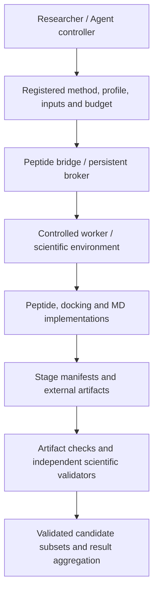

# BioMA-Peptide

**Domain tools, controlled scientific jobs and traceable results for peptide computation.**

[中文说明](README_zh.md) · [Bridge API](bridge/README.md) · [Validation record](bridge/MIGRATION_VALIDATION.md)

> Status: the independent bridge and later peptide domain increments are implemented, with targeted regression tests and limited real computation. The complete Nectin-4 workflow and production MD have not passed acceptance. Merging code does not grant scientific approval.

## Motivation and design background

Peptide research crosses chemical topology, conformer search, structure prediction, docking, parameterization and molecular dynamics. A successful model response cannot establish that downstream stages used the same chemical state, that parameters apply to the system, or that outputs were independently checked. Long calculations also need an identity that survives a conversation timeout.

BioMA-Peptide narrows the inherited BioMA environment to peptide computation and result aggregation. It reuses existing scientific tools and migrates genuine later relaxation, parameter-source and MD implementations with provenance hashes. The standalone `bioma_peptide_bridge` namespace avoids collisions between distributions that both provide `bioma`.

## Contributions and strengths

- **Chemical identity across stages:** retain authoritative topology, charge, stereochemistry, crosslinks, conformer and parameter identity rather than reconstructing the ligand graph approximately from PDB/PDBQT.
- **Separate execution and validation:** `execution_status`, `artifact_validation_status` and `scientific_validation_status` are independent. Unknown/failed/interrupted JSON results fail closed; partial delivery includes only independently validated candidates.
- **Persistent jobs:** submit, status, collect, cancel, resume and reattach; SQLite plus file locks protect idempotency. Cancellation targets the controlled process group. Checkpoint reuse requires matching inputs and configuration.
- **Restricted invocation:** the Agent submits registered method/profile/input IDs and budgets. Trusted profiles pin source, interpreter and executables; commands use structured arguments and `shell=False`.
- **External large artifacts:** streaming SHA256 and URI/size/version/producer/identity/retention references keep trajectories out of Agent observations and base64 payloads.
- **Distinct measurement semantics:** experimental Kd, functional measurements, enrichment, model/docking scores and MD metrics remain separate. Missing, undetected, below-limit and valid-negative observations are not silently converted to zero.

These are execution and evidence-management contributions, not a new affinity algorithm or a guarantee of scientific-engine accuracy.

## Architecture and repository boundary



This public repository includes the bridge, domain tools, skills and inherited `src/bioma` runtime/Web UI. The tested single-Conversation OpenHands controller lives in a separate private BioMA worktree and is **not included here**. Installing this bridge does not switch `BioMA.run/query` or the Web entry point to OpenHands; there is no completed `agent_engine=openhands` switch in this public distribution.

Production admission binds independent use review and worker qualification to inputs, parameters, engine, scope and resources. Agent-written success claims cannot grant it. Some CPU/RSS/GPU budgets use periodic sampling. The GPU lease coordinates only one broker, not hard cgroup/VRAM isolation or a multi-tenant scheduler.

## Computational workflow

| Stage | Method | Outputs and constraints |
|---|---|---|
| 0. Register task/data | Target/domain, chemical state, sources, replicate relationships, use profile | Case-specific charge and receptor-retention policies must be explicit |
| 1. Build topology | `build_crosslinked_peptide_topology` from a chemical spec | Authoritative graph, chemical identity and stage manifest |
| 2. Generate conformers | RDKit ensemble or Boltz prediction path | Candidates and software/model versions; external dependencies remain required |
| 3. Optimize/select/export | xTB optimization, topology/structure checks and clustering | Configuration hash, checkpoint and partial/interrupted semantics; no cross-configuration checkpoint reuse |
| 4. Prepare receptor/pockets | Profile-controlled receptor preparation and P2Rank | Retention/repair audit; pockets are model hypotheses |
| 5. Dock | Global DiffDock, chemical/geometric filtering, pocket assignment | Candidate evidence and explicit rejection reasons |
| 6. Parameterize/relax | Reviewed TBMB-Met RESP templates/bonded terms; ff14SB/TLEaP assembly and restrained OpenMM relaxation | Sequence-specific topology/coordinates and parameter hashes; no approximate-parameter fallback |
| 7. Rescore | Vina score-only/local-only on relaxed poses | Linked computational scores, not experimental Kd |
| 8. Prepare/run MD | Stage A → build → minimize → NVT/NPT equilibrate → segmented production | Source is migrated; real case use review and complete GPU broker qualification remain pending |
| 9. Aggregate | Independently checked candidates, artifact references and separate measurements | Docking/MD evidence is not affinity; end-to-end MM/GBSA was not qualified in this migration |

Parameter qualification is a prerequisite for the computation that consumes it, regardless of table order. RDKit, Boltz and xTB paths are selected for the task; not every workflow must execute every branch.

## Core skills and tool exposure

- [crosslinked-peptide-structure](skills/model_capabilities/our-skills/sk.8c792d469d40b961/crosslinked-peptide-structure/SKILL.md): chemical spec, topology, conformers, xTB, validation/selection/export, with schema, stopping rules and stage-artifact references.
- [tbmb-bicyclic-peptide-docking](skills/model_capabilities/our-skills/sk.4fbe227040e54d55/tbmb-bicyclic-peptide-docking/SKILL.md): parameter packaging, receptor preparation, P2Rank, DiffDock, OpenMM relaxation and local Vina rescoring. It explicitly ends before MD; current +5/TBMB assumptions apply only to matching profiles.

Skills guide procedures; they are neither execution permissions nor scientific validators. The bridge explicitly adapts six structure tools plus `prepare_receptor`, `detect_pockets`, `diffdock_screen` and `vina_refine`. The six structure tools are topology building, RDKit and Boltz conformer generation, xTB optimization, conformer validation/clustering/selection, and ensemble export. Run `catalog` for exact names and schemas.

`parameterize_tbmb_scaffold` and `relax_complexes` source/skill support exists but is not automatically added to that ten-tool broker allowlist. `tbmb_md_production` is a separately gated method; other MD modules are not all exposed as uniform Agent actions.

## Directory tree

Main paths only; inherited auxiliary modules and non-core skills are omitted.

```text
bioma-peptide/
├── bridge/                         # Standalone bioma_peptide_bridge distribution
│   ├── pyproject.toml
│   ├── src/bioma_peptide_bridge/
│   │   ├── cli.py                  # catalog, ingest, job lifecycle commands
│   │   ├── broker.py               # SQLite registry, idempotency, reconnect
│   │   ├── worker.py               # Detached supervisor and process budgets
│   │   ├── domain.py               # Pinned source / executable adapters
│   │   ├── contracts.py            # Result states and artifact identity
│   │   ├── admission.py            # Production-use admission
│   │   ├── validators.py           # Independent chemical graph checks
│   │   └── data.py                 # Measurement semantics and split guards
│   ├── tests/legacy/               # Migrated scientific-stage regressions
│   ├── MIGRATION_VALIDATION.md
│   └── migration-provenance.json
├── tools/our_tools/
│   ├── crosslinked_peptide_structure.py
│   ├── _crosslinked_impl/          # Topology, conformers, xTB, export
│   ├── tbmb_bicyclic_docking.py     # Receptor, pockets, docking, relaxation
│   ├── tbmb_parameter_source.py    # Parameter-source workflow
│   └── tbmb_md_*.py                # Stage A, build, minimize, equilibrate, production
├── skills/model_capabilities/our-skills/
│   ├── sk.8c792d469d40b961/crosslinked-peptide-structure/
│   └── sk.4fbe227040e54d55/tbmb-bicyclic-peptide-docking/
├── skills/_meta/                  # Stable skill IDs and location registry
├── src/bioma/                     # Legacy runtime, tools, evidence and Web UI
├── configs/                       # Existing runtime configurations
├── examples/                      # Existing examples
├── scripts/                       # Development / maintenance utilities
├── tests/                         # Legacy application tests
├── devices/                       # Existing execution-device integration
├── pyproject.toml                 # Legacy bioma-peptide distribution
├── README.md
└── README_zh.md
```

## Development and validation quick start

### Install only the standalone bridge

Use Linux, Python ≥3.11, `/proc`, POSIX locks and local SQLite. The bridge has no third-party runtime dependencies; its build needs setuptools. Do not install two distributions providing `bioma` in the same environment.

```bash
git clone https://github.com/YuyangSunshine/bioma-peptide.git
cd bioma-peptide
python3.11 -m venv .venv-bridge
source .venv-bridge/bin/activate
python -m pip install -e ./bridge
bioma-peptide --help
bioma-peptide catalog --source-root "$PWD"
```

`catalog` inspects source schemas/versions/classification; visibility does not establish installed dependencies or production authorization. This does not install OpenHands, model weights, OpenMM, AmberTools, xTB, P2Rank, DiffDock or Vina.

### Run migration regressions

```bash
python -m pip install pytest pydantic PyYAML rdkit
export PYTHONPATH="$PWD/bridge/src"
export PEPTIDE_SOURCE_ROOT="$PWD"
python -m pytest bridge/tests -q -p no:cacheprovider
```

This covers bridge and migrated stage regressions, not all inherited application tests under root `tests/`. Recorded scientific test environment: Python 3.11.16, RDKit 2026.3.1, OpenMM 8.6.1; the independent graph checker used RDKit 2025.09.6. The development install above is not a scientific lockfile. Reproducible runs must record actual versions and pin checker, source, input and engine identity in profiles.

### Run a persistent job without a model

This standard-library synthetic smoke test creates a fresh temporary directory, reads no real peptide data and grants no scientific permission.

```bash
python - <<'PYCODE'
import json, tempfile, time
from pathlib import Path
from bioma_peptide_bridge.broker import Broker
from bioma_peptide_bridge.contracts import sha256

root = Path(tempfile.mkdtemp(prefix="peptide-canary-"))
inputs = root / "inputs"
inputs.mkdir()
(inputs / "seed.txt").write_text("synthetic engineering fixture\n")
budget = dict(seconds=10, cpu_seconds=5, memory_bytes=256*1024**2,
              output_bytes=2*1024**2, cpus=1)
registry = {
    "input_root": str(inputs),
    "inputs": {"seed": {"path": "seed.txt", "sha256": sha256(inputs / "seed.txt")}},
    "profiles": {"canary": {
        "method": "engineering_canary", "approved": True,
        "review_id": "synthetic-engineering-only", "purpose": "engineering_only",
        "inputs": ["seed"], "identity": {"chemical": "synthetic"},
        "resource_caps": budget,
    }},
}
path = root / "registry.json"
path.write_text(json.dumps(registry))
broker = Broker(root / "jobs", path)
job = broker.submit(profile="canary", input_refs=["seed"],
                    idempotency_key="canary-v1", resources=budget)["job_id"]
for _ in range(150):
    state = broker.status(job)
    if state["status"] not in {"queued", "running"}:
        break
    time.sleep(0.1)
print(json.dumps({"root": str(root), "job_id": job, "state": state}, indent=2))
assert state["status"] == "completed", state
result = broker.collect(job)
print(json.dumps(result, indent=2))
assert result["execution_status"] == "ok", result
# Engineering execution is not scientific approval.
assert not result["deliverable"], result
PYCODE
```

Real methods require an operator-maintained registry, registered inputs and a scientific environment. Submit with `bioma-peptide submit --root JOB_ROOT --registry REGISTRY --request REQUEST`. Subsequent `status/collect/cancel/resume/reattach` use the same root/registry and `--job-id`. See [bridge/README.md](bridge/README.md) for fields and budgets.

For the inherited Web/runtime, install the root distribution in a separate environment and consult `bioma-peptide-web --help`. It is not a Web frontend for the bridge or the main entry qualified by this migration.

## Implemented versus pending

| Capability | Evidence / status |
|---|---|
| Independent package, ten-tool contracts, persistent jobs, external references and basic data semantics | Implemented; 34 targeted regressions passed |
| Later domain increments and two core skills | Migrated with original/migrated source hashes |
| Real scientific tool invocation | Migrated RDKit glycine topology ran through the broker and passed execution, artifact and independent graph validation; limited coverage |
| Real GPU engine | Two-particle synthetic OpenMM CUDA startup, checkpoint restore and controlled child cancellation passed; not a peptide or persistent GPU broker qualification |
| Real OpenHands model invocation | Short task verified in the private adapter; controller not distributed here |
| Complete Nectin-4 workflow | Not passed: conflicting review records and a stereochemical mismatch in one of three candidates |
| New production MD / full GPU broker qualification | Pending / not admitted; no new production trajectory started |
| Scientific validators for every stage / uniform Agent exposure for all added methods | Incomplete; current independent graph checks cannot approve docking or MD |
| Wet-lab/NGS dataset migration, affinity accuracy validation, end-to-end MM/GBSA | Not completed by this migration; no result guarantee |

Real local evidence, case sequences, parameter packages and run outputs are excluded from the public repository. Historical trajectories do not qualify the new entry point. See [validation scope](bridge/MIGRATION_VALIDATION.md) and [source provenance](bridge/migration-provenance.json).
