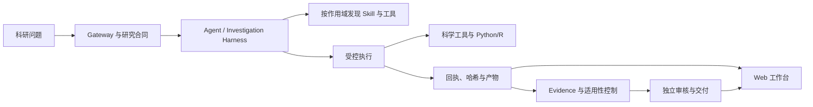

# BioMA-Peptide

**面向多肽干实验计算研究的、以证据为基础的自主执行智能体。**

[English README](README.md)

BioMA-Peptide 是从 BioMA 清理迁移出的多肽垂域项目。仓库保留生产级智能体
Runtime、受控科研执行、来源与证据机制、Web 工作台、首页案例、科学工具和精简后的
技能库；历史评估运行、实验快照、生成产物、日志及旧项目文档均不迁移。

## 项目动机

多肽计算研究不只是生成一条序列或调用一个预测器。一个可信的科研智能体还必须保存
准确的序列与结构身份，区分预测和实验观测，将下游工作绑定到真实使用的结果，保留
执行回执，并在条件变化时只修订真正受影响的结论。BioMA-Peptide 提供这些执行与证据
边界；科学方法、结果选择和下一步行动仍由 Agent 与研究者决定。

项目面向多肽序列分析、结构预测流程、分子对接、成药性与可开发性评估、文献和公共
科研资源检索、可复现 Python/R 分析及报告生成。它**不能**替代湿实验验证、临床审核
或领域专家判断。

## 核心能力

- **受控 Agent 循环**：模型与工具预算、Checkpoint、失败恢复和显式交付合同。
- **真实计算执行**：隔离的 Python/R 与 Shell 分析，输入、输出、时限和产物均可核查。
- **科学 Grounding**：类型化科研结果、精确依赖引用、用途适用性检查、Claim/Evidence
  关系和独立交付审核。
- **全链路追踪**：追加式 Ledger、哈希、回执、产物版本、来源身份和可回放科学状态。
- **多肽工具链**：序列与结构工具、环肽/交联肽结构、渗透性与可开发性辅助、对接相关
  工具以及获准公共科研资源。
- **精简技能库**：保留 126 个与多肽、蛋白、结构、对接、文献、报告和可视化有关的
  Skill。Skill 只能提供指导，不能自行取得工具执行权限。
- **Web 工作台**：实时运行状态、对话历史、证据与来源视图、产物预览、报告、图表、
  序列视图及交互式三维结构。

## 架构



模型决定采取什么科学行动、使用什么方法以及复用哪个结果。Runtime 负责检查权限和
行动事实，将执行绑定到真实输入与输出，并阻止未经核验的结果自动获得科学权威。

## 快速开始

需要 Python 3.10+；CI 使用 Python 3.12。

```bash
git clone https://github.com/YuyangSunshine/bioma-peptide.git
cd bioma-peptide
python -m venv .venv
source .venv/bin/activate
python -m pip install --upgrade pip
python -m pip install -e ".[dev,prediction,analysis]"
cp .env.example .env
```

无需模型凭据的确定性 Web 冒烟测试：

```bash
bioma-peptide-web --toy --host 127.0.0.1 --port 8014
```

浏览器打开 `http://127.0.0.1:8014`。真实模型运行需要在私有环境文件中设置
`CHATEXCEL_API_KEY`：

```bash
bioma-peptide-web --config configs/bioma.yaml --env-file .env
```

仓库配置使用兼容 OpenAI 的模型接口。凭据只从环境变量读取，绝不能提交到 Git。
本地 AlphaFold/ColabFold 与 protocols.io 的可选变量见 `.env.example`。

## 首页案例

Web 首页保留六个 BioMA 案例，用于展示产物、报告和证据界面：

1. MASH 肝组织 DESeq2 分析。
2. CellChat 细胞通信分析。
3. B2M AlphaFold2 结构及交互式三维查看。
4. 胃癌单细胞数据集检索与元数据预览。
5. 胶质母细胞瘤 GRN 与转录因子活性报告。
6. 人左心室/T2D 共表达网络报告。

这些内容是界面和工作流示例，不代表仓库内置了全部原始数据，也不保证新环境无需依赖
即可复现。重新运行仍需要对应数据、软件、权限和计算资源。

## 项目树

```text
bioma-peptide/
├── src/bioma/             # API、Runtime、Harness、Evidence、Web 服务与 UI
│   ├── core/              # 科学合同、状态、关系与数据模型
│   ├── runtime/           # 准入、执行、Ledger、回执与控制
│   ├── harness/           # 调查循环、代码执行与交付审核
│   ├── backends/          # 科研和数据分析后端
│   ├── skills/            # Skill 发现与作用域加载
│   └── static/            # Web 工作台与首页案例目录
├── tools/                 # 受 Runtime 管理的科研工具
├── skills/                # 精简的多肽/蛋白科学技能库
├── configs/               # Runtime 配置
├── devices/               # 可选设备能力清单
├── examples/              # 确定性 API 与协议示例
├── tests/                 # 聚焦生产能力的回归测试
└── scripts/               # 核心 CI 门禁
```

未迁移内容包括：`evaluation/`、`experiments/`、历史 `docs/`、生成的
`artifacts/`、运行数据库、结果快照、缓存和日志。

## 开发与验证

```bash
python -m pytest -q
scripts/run_core_runtime_gate.sh
python examples/claim_evidence_demo.py
```

新增多肽 Method 时，应明确输入类型、结果合同、限制条件、所需工具、核验义务及产物。
不要把某个案例的正确答案写进 Runtime。Skill 或模型叙述本身不是 Evidence；只有获准的
真实执行和适用核验才能支持科研结论。

## 科学与安全边界

- 预测结果和数据库注释属于计算证据，不等于实验确认。
- 工具调用成功不自动代表结果适用于当前科研用途。
- 公共资源访问保持白名单和大小限制；科研执行环境不开放任意网络或任意安装依赖。
- 历史产物不可改写；复用、重新生成和重新计算都必须形成新的可追踪行动。
- 第三方 Skill 保留各自的署名和许可证文件；再分发或商用前请逐项核对条款。

