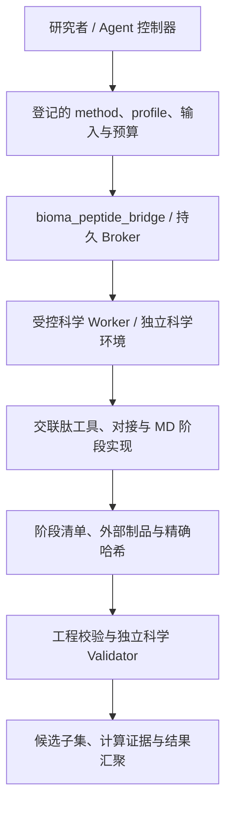

# BioMA-Peptide

**面向多肽计算的领域工具、受控作业执行与可追溯结果汇聚。**

[English](README.md) · [桥接接口](bridge/README.md) · [迁移验证](bridge/MIGRATION_VALIDATION.md)

> 当前状态：多肽领域增量与独立 bridge 已实现，工程回归和有限真实计算已验证；完整 Nectin-4 科学流程与生产 MD 尚未验收通过。代码合并、工具返回成功、科学验证通过是不同事件。

## Motivation：为什么做这个项目

多肽计算需要跨越化学身份、构象搜索、结构预测、对接、参数化和分子动力学。单次模型回答或一次工具调用无法证明：后续计算使用的是同一化学状态，参数适用于当前体系，或者输出真的经过了检查。长计算也不应随聊天超时丢失身份或重复启动。

BioMA-Peptide 将这些问题变成明确的工程接口：输入和制品绑定哈希，科学方法通过登记 profile 调用，长任务具有持久 job ID，计算分数与实验测量分别汇聚。目标是让多肽研究过程可执行、可核查、可恢复，而不是用 Agent 的文字声明代替科学证据。

## 设计背景与主要贡献

项目从 BioMA 的通用执行环境收敛到多肽领域。已有交联肽工具继续复用，真实后续的复合物松弛、参数来源和 MD 阶段实现按来源哈希迁入；不重写已经可用的科学方法。新增桥接包采用 `bioma_peptide_bridge` 命名空间，避免两份 `src/bioma` 在同一环境中相互覆盖。

主要贡献与特色：

- **化学身份贯穿各阶段**：保留序列、交联图、电荷、立体状态、构象与参数身份，不能从 PDB/PDBQT 近似重建权威配体图后当作原输入。
- **三层结果状态**：分别记录 `execution_status`、`artifact_validation_status`、`scientific_validation_status`。JSON 字符串中的失败、未知状态和中断不会自动变成成功；部分成功只交付独立验证的候选子集。
- **持久作业生命周期**：`submit/status/collect/cancel/resume/reattach`，SQLite 与文件锁保护幂等提交；取消作用于受控进程组，恢复需匹配输入与配置身份。
- **受限执行接口**：Agent 只提交登记的方法、输入引用和预算；可信 profile 固定源码、解释器及可执行文件，使用结构化参数和 `shell=False`。
- **大制品留在存储层**：用 URI、大小、SHA256、版本、producer job、身份和保留策略引用输出，分块计算哈希，不将轨迹转成 base64 放入上下文。
- **实验与计算分开**：Kd、功能测量、筛选富集、模型评分、对接评分和 MD 指标分别存储；“/”“-”、未检测、低于检测限和有效阴性不自动等价于零。

这些贡献是执行与证据管理能力，不是新的亲和力预测算法，也不是对现有科学引擎精度的保证。

## 框架结构



公开仓库包含 `bridge/`、领域工具、skills，以及保留的旧 `src/bioma` runtime/Web。已验证的 OpenHands 单 Conversation 控制器位于独立私有 BioMA 工作树，**不包含在本公开仓库中**；其真实模型短任务结果不能当作公开包开箱即用的 OpenHands 功能。旧 `BioMA.run/query` 和 Web 入口不会因安装 bridge 自动切换为 OpenHands，也没有可宣称已完成的 `agent_engine=openhands` 开关。

生产 MD 的代码存在不等于准入。固定用途审核和外部 worker 资格记录必须绑定具体输入、参数、引擎、候选范围和资源；Agent 自己写“通过”不授予权限。CPU/RSS/GPU 的部分限制为周期采样，GPU lease 仅协调同一 broker，不是硬 cgroup/VRAM 隔离或多租户调度系统。

## 多肽计算阶段与计算方法

| 阶段 | 如何计算 | 主要输出与约束 |
|---|---|---|
| 0. 任务与数据登记 | 登记靶点/结构域、化学状态、来源、重复测量和用途 profile | 不把当前案例的 +5 电荷或受体删留策略当作所有靶点默认值 |
| 1. 拓扑构建 | `build_crosslinked_peptide_topology` 根据化学 spec 构建交联图 | 权威拓扑、化学身份与 stage manifest |
| 2. 构象生成 | RDKit 构象集合或 Boltz 结构预测路径 | 候选构象、模型/软件版本；依赖外部模型及其许可/资源 |
| 3. 优化与选择 | xTB 优化；拓扑/结构检查、聚类、选择与导出 | `config_hash`、checkpoint、失败/中断与部分成功语义；不同配置不能复用旧断点 |
| 4. 受体与口袋 | `prepare_receptor` 按 profile 保留成分，P2Rank 检测口袋 | 受体与删留/修补记录；口袋只是模型假设 |
| 5. 对接筛选 | DiffDock 全局筛选，化学/几何过滤与口袋归属 | 对接候选和失败原因；不为凑数量伪造候选 |
| 6. 参数封装与松弛 | 复用审核后的 TBMB-Met 模板/RESP 与 bonded terms；ff14SB/TLEaP 组装，OpenMM 受限松弛 | 序列专用拓扑/坐标、参数哈希、能量/力/几何检查；禁止临时近似参数冒充合格参数 |
| 7. 局部复评分 | Vina score-only / local-only 对松弛候选评分 | 保留与候选身份关联的计算分数，不解释为实验 Kd |
| 8. MD 准备与执行 | Stage A 受体准备 → build → minimize → NVT/NPT equilibrate → 分段 production | 各阶段源码已迁入；真实参数用途审核、GPU broker canary 与全链验收尚未完成 |
| 9. 汇聚与解释 | 汇聚独立验证候选、制品引用与分列测量 | MD 稳定性/对接分数不等于亲和力；本迁移未完成 MM/GBSA 全链验收 |

阶段 6 的参数资格必须在相应计算前满足，不能因表格顺序而跳过。Boltz、RDKit、xTB 是按任务选择的路径，不要求每个项目机械地运行所有分支。

## 核心 skills 与调用边界

- [crosslinked-peptide-structure](skills/model_capabilities/our-skills/sk.8c792d469d40b961/crosslinked-peptide-structure/SKILL.md)：化学 spec、交联拓扑、构象生成、xTB、验证选择与导出；随附化学 schema、停止规则和阶段制品合同。
- [tbmb-bicyclic-peptide-docking](skills/model_capabilities/our-skills/sk.4fbe227040e54d55/tbmb-bicyclic-peptide-docking/SKILL.md)：参数封装、受体准备、P2Rank、DiffDock、OpenMM 松弛和 Vina 局部复评分；该 skill 明确止于 MD 之前，现有 +5/TBMB 假设仅适用于相符 profile。

Skill 是流程指导，不是执行许可或科学 validator。bridge 当前显式适配十个原工具：六个结构工具与 `prepare_receptor`、`detect_pockets`、`diffdock_screen`、`vina_refine`。新增 `parameterize_tbmb_scaffold`、`relax_complexes` 的源码与 skill 已存在，但不是自动加入这十项 broker 授权清单。MD 的 `tbmb_md_production` 是单独受准入控制的接口；其余 MD 模块的存在不代表已拥有统一 Agent 工具注册。

## 目录结构

这是主要目录，省略继承的辅助模块与大量非核心 skills。

```text
bioma-peptide/
├── bridge/                         # Standalone bioma_peptide_bridge distribution
│   ├── pyproject.toml
│   ├── src/bioma_peptide_bridge/
│   │   ├── cli.py                  # catalog, ingest, job lifecycle commands
│   │   ├── broker.py               # SQLite registry, idempotency, reconnect
│   │   ├── worker.py               # Detached supervisor and process budgets
│   │   ├── domain.py               # Pinned source / executable adapters
│   │   ├── contracts.py            # Result states and artifact identity
│   │   ├── admission.py            # Production-use admission
│   │   ├── validators.py           # Independent chemical graph checks
│   │   └── data.py                 # Measurement semantics and split guards
│   ├── tests/legacy/               # Migrated scientific-stage regressions
│   ├── MIGRATION_VALIDATION.md
│   └── migration-provenance.json
├── tools/our_tools/
│   ├── crosslinked_peptide_structure.py
│   ├── _crosslinked_impl/          # Topology, conformers, xTB, export
│   ├── tbmb_bicyclic_docking.py     # Receptor, pockets, docking, relaxation
│   ├── tbmb_parameter_source.py    # Parameter-source workflow
│   └── tbmb_md_*.py                # Stage A, build, minimize, equilibrate, production
├── skills/model_capabilities/our-skills/
│   ├── sk.8c792d469d40b961/crosslinked-peptide-structure/
│   └── sk.4fbe227040e54d55/tbmb-bicyclic-peptide-docking/
├── skills/_meta/                  # Stable skill IDs and location registry
├── src/bioma/                     # Legacy runtime, tools, evidence and Web UI
├── configs/                       # Existing runtime configurations
├── examples/                      # Existing examples
├── scripts/                       # Development / maintenance utilities
├── tests/                         # Legacy application tests
├── devices/                       # Existing execution-device integration
├── pyproject.toml                 # Legacy bioma-peptide distribution
├── README.md
└── README_zh.md
```

## 开发与验证快速启动

### 1. 仅安装独立 bridge

需要 Linux、Python ≥3.11、可用 `/proc`、POSIX 文件锁和本地 SQLite。核心包无第三方运行依赖；构建需要 setuptools。不要在一个 venv 同时安装两份提供 `bioma` 的发行包。

```bash
git clone https://github.com/YuyangSunshine/bioma-peptide.git
cd bioma-peptide
python3.11 -m venv .venv-bridge
source .venv-bridge/bin/activate
python -m pip install -e ./bridge
bioma-peptide --help
bioma-peptide catalog --source-root "$PWD"
```

`catalog` 输出源码可见的 schema/版本/结果分类；列出工具并不表示其依赖已安装或已获生产许可。这里不安装 OpenHands、模型权重、OpenMM、AmberTools、xTB、P2Rank、DiffDock 或 Vina。

### 2. 运行迁移回归

```bash
python -m pip install pytest pydantic PyYAML rdkit
export PYTHONPATH="$PWD/bridge/src"
export PEPTIDE_SOURCE_ROOT="$PWD"
python -m pytest bridge/tests -q -p no:cacheprovider
```

该命令覆盖 bridge 与迁入阶段回归，不是对旧应用 `tests/` 全部测试的通过声明。验证环境使用 Python 3.11.16、RDKit 2026.3.1、OpenMM 8.6.1；独立图 checker 实跑使用 RDKit 2025.09.6。上面的开发安装命令不锁定科学软件版本，正式复现必须记录实际版本并在 profile 中固定 checker/输入/源码/引擎身份。

### 3. 不调用模型的持久作业 smoke test

以下用标准库运行合成工程任务，自动创建独立临时目录，不读取真实多肽数据，也不批准科学任务。

```bash
python - <<'PYCODE'
import json, tempfile, time
from pathlib import Path
from bioma_peptide_bridge.broker import Broker
from bioma_peptide_bridge.contracts import sha256

root = Path(tempfile.mkdtemp(prefix="peptide-canary-"))
inputs = root / "inputs"
inputs.mkdir()
(inputs / "seed.txt").write_text("synthetic engineering fixture\n")
budget = dict(seconds=10, cpu_seconds=5, memory_bytes=256*1024**2,
              output_bytes=2*1024**2, cpus=1)
registry = {
    "input_root": str(inputs),
    "inputs": {"seed": {"path": "seed.txt", "sha256": sha256(inputs / "seed.txt")}},
    "profiles": {"canary": {
        "method": "engineering_canary", "approved": True,
        "review_id": "synthetic-engineering-only", "purpose": "engineering_only",
        "inputs": ["seed"], "identity": {"chemical": "synthetic"},
        "resource_caps": budget,
    }},
}
path = root / "registry.json"
path.write_text(json.dumps(registry))
broker = Broker(root / "jobs", path)
job = broker.submit(profile="canary", input_refs=["seed"],
                    idempotency_key="canary-v1", resources=budget)["job_id"]
for _ in range(150):
    state = broker.status(job)
    if state["status"] not in {"queued", "running"}:
        break
    time.sleep(0.1)
print(json.dumps({"root": str(root), "job_id": job, "state": state}, indent=2))
assert state["status"] == "completed", state
result = broker.collect(job)
print(json.dumps(result, indent=2))
assert result["execution_status"] == "ok", result
# Engineering execution is not scientific approval.
assert not result["deliverable"], result
PYCODE
```

真实工具需要另行配置操作者维护的 registry、登记输入和科学环境。使用 `bioma-peptide submit --root JOB_ROOT --registry REGISTRY --request REQUEST` 提交；后续 `status/collect/cancel/resume/reattach` 使用相同 root/registry 与 `--job-id`。完整字段和预算约束见 [bridge/README.md](bridge/README.md)。

旧 Web/runtime 可在另一个环境安装仓库根包后使用 `bioma-peptide-web --help`；它不是上述多肽 bridge 的 Web 前端，也不是本次验证的主要入口。

## 实现与验证状态

| 能力 | 当前状态 |
|---|---|
| 独立命名空间、十工具合同、持久 jobs、大文件引用、基础数据语义 | 已实现；34 项针对性回归通过 |
| 新增领域源码和两个核心 skills | 已迁入；来源/迁入哈希见 provenance |
| 实际科学工具执行 | 迁入 RDKit 甘氨酸拓扑经过 broker 实跑，执行/制品/独立图验证通过；覆盖范围有限 |
| 实际 GPU 引擎 | 两粒子合成 OpenMM CUDA 启动、checkpoint 恢复、受控子进程取消通过；不是肽体系或持久 GPU broker 验收 |
| OpenHands 模型调用 | 私有适配器真实短任务已验证；该控制器不随公开仓库发布 |
| 真实 Nectin-4 全链 | 未通过；审核记录冲突，三条候选中一条立体状态不匹配 |
| 新生产 MD、GPU broker 完整资格试验 | 未完成/未准入；未启动新的生产轨迹 |
| 全阶段科学 validator、全部新增方法的统一 Agent 暴露 | 尚不完整；当前独立图 checker 不能批准对接或 MD |
| 湿实验/NGS 数据集迁入、亲和力预测准确性验证、MM/GBSA 全链 | 本迁移未完成，不作能力或结果保证 |

本地真实证据、序列、参数包和运行制品不随公开代码发布。现有旧轨迹也不构成新入口的生产验收。详细范围见 [迁移验证记录](bridge/MIGRATION_VALIDATION.md) 和 [源码来源清单](bridge/migration-provenance.json)。
