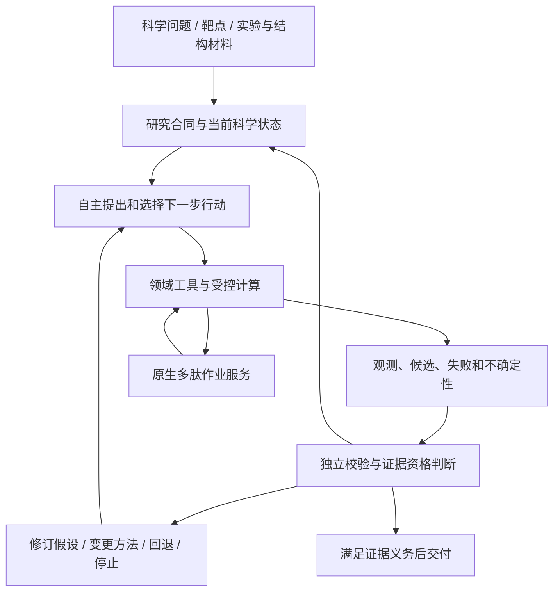

# BioMA-Peptide

**面向多肽、环肽与双环肽研究的自主科学智能体：用领域约束选择行动，用独立证据校验结论。**

[English](README.md) · [原生计算接口](docs/peptide/README.md) · [迁移验证](docs/peptide/MIGRATION_VALIDATION.md)

> 当前状态：多肽计算已整合到 BioMA 主包，自主研究与独立校验能力保留，工程回归和有限真实计算已验证；完整 Nectin-4 科学流程与生产 MD 尚未验收通过。代码合并、工具返回成功、科学验证通过是不同事件。

## 科学背景与研究动机

### 科学智能体缺少的，不只是更多工具

能写出脚本、调用结构预测器或完成一次对接，并不等于能够回答一个科学问题。ScienceAgentBench 将程序执行与科学任务结果分别评价，显示现有语言智能体距离端到端科研自动化仍有明显差距。它不是多肽基准，但提示了本项目要检验的关键区别：**完成动作，是否真的消除了研究中的不确定性？** [ScienceAgentBench](https://arxiv.org/abs/2410.05080)

在多肽研究中，智能体需要判断下一步应扩大构象搜索、修补受体、检查参数，还是停止一个不可信候选；也需要在证据冲突时回退，而不是把每个程序“成功退出”连成一个看似完整的结论。BioMA-Peptide 的研究目标，是在 BioMA 自主研究与证据校验能力上，让这些决策具有明确的多肽化学语义。我们尚未证明它优于所有通用 scientific agents；这是一项需通过领域任务检验的目标，而非已完成的 benchmark 结论。

### 为什么是多肽、环肽和双环肽

多肽为识别蛋白表面和调节蛋白相互作用提供了不同于传统小分子的设计空间，但亲和力、选择性、稳定性和可开发性必须共同考虑。环化可以约束构象，却不会自动解决吸收、稳定性和靶点识别之间的取舍；已有研究需要联合筛选活性、稳定性和通透性来得到可口服候选。[Merz et al., Nature Chemical Biology](https://www.nature.com/articles/s41589-023-01496-y)

环肽也不能简单当作“首尾相连的小蛋白”。预测方法需要显式处理环状拓扑；针对 cyclic peptides 的 AlphaFold2 改造研究说明，蛋白预测能力不能不经适配就视为环肽设计能力。[Cyclic peptide structure prediction and design](https://www.nature.com/articles/s41467-025-59940-7)

双环肽进一步引入多个环的耦合约束和交联化学。在本项目的 TBMB 体系中，序列之外还必须保留交联位点、共价连接、电荷与立体状态。我们据此将领域难点归纳为：搜索哪类构象、哪些结构在化学上有效、哪种受体状态适合检验结合假设，以及现有参数是否适用于该体系。这些判断不应被一次对接分数替代，也不能由固定阶段顺序自动回答。

### 靶点难度：以当前可核验的 Nectin-4 案例为起点

Nectin-4 的结构材料不能直接当作已准备好的多肽受体。9KKJ 来源于 Nectin-4 与抗体的复合物研究，而不是本项目双环肽的实验结合结构；选择结构域、处理复合物成分并提出多肽结合假设，是不同的科学步骤。[9KKJ 原始结构研究](https://www.jbc.org/article/S0021-9258%2825%2902668-7/fulltext)

本地案例还存在受体缺失区修补、构建体范围、参数用途和候选立体状态的一致性问题。它们构成了比“让工具运行起来”更实质的验收难点：一个候选结构与参考化学状态不一致时，智能体应定位冲突并停止相应结论传播，而不是继续运行 MD 来掩盖上游问题。目前 README 只将 Nectin-4 列为已取得真实材料的案例；其他靶点需有可核验材料后再逐项说明，不从靶点名称推断已完成验证。

## 设计与主要贡献

**自主选择研究动作，独立检查动作产生的证据。** 两者缺一不可。项目保留 BioMA 的研究任务解释、候选行动生成、科学控制、修订与交付审核；多肽模块为这些决策提供领域方法、化学身份和长计算能力，不另建一个替代研究智能体的固定 pipeline。

- **以问题和证据驱动行动**：`BioMA` 研究入口、`scientific_control` 的候选行动/修订和 `harness` 的工具循环共同支撑自主研究。具体策略取决于配置，`adaptive_v3` 是显式可选策略，并非默认自动启用。
- **化学约束参与校验**：在序列、交联图、电荷、立体状态与参数身份之间保持一致；失败或未知状态不能借由文字总结获得科学信用。
- **验证与生成分离**：工程制品检查、固定科学 validator 和研究交付审核有不同职责。Agent 的解释不能代替结构或参数的独立检查。
- **长计算成为可管理的研究动作**：持久 job ID、取消、续跑、资源预算和外部制品引用保留在主包内，支持研究循环查询和处理结果，而不规定下一步必须做哪项计算。
- **实验和模型证据分层汇聚**：筛选富集、实验 Kd、功能测量、结构预测、对接和 MD 分列保存。对接分数不是实验亲和力，缺失观测不是有效阴性。

这是研究能力与领域约束的结合，不是新的对接或力场算法。完整自主肽设计效果、跨靶点泛化和相对基线收益仍需进一步实测。

## 整体框架：自主研究闭环，而非固定流水线



执行层可以有先后依赖，例如 MD 需要合格拓扑与参数；**依赖关系不等于固定研究决策**。Agent 可以先核对实验材料、选择不同构象方法、放弃失败候选或返回受体准备阶段。当前决策与修订的回归测试使用受控测试案例，不应宣传为已经完成所有真实靶点的自主发现。

### 为什么移除 bridge

原 `bridge/` 是迁移期间避免两份 `bioma` 包冲突的独立发行包。如今相关领域代码已进入本仓库，继续保留第二套安装和假模块加载没有必要。其功能已收回 `src/bioma/peptide/`，使用同一发行包与 CLI；测试移至 `tests/peptide/`，执行协议文档移至 `docs/peptide/`。`bioma` 顶层采用惰性导入，使计算 worker 不必启动模型或完整研究运行时。后台进程隔离仍保留，因为长计算的生命周期与 Agent 会话不同；这是执行边界，不是另一层桥接产品。

公开仓库的 `BioMA.run/query` 仍使用已有研究控制器。此前验证的 OpenHands 控制器属于独立私有项目，不在这里伪称已集成，也不另套一个 OpenHands 与旧循环相互驱动的双重决策环。所有新增 MD 方法的统一 Agent 暴露和完整科学 validator 仍未完成。资源的部分限制为周期采样，GPU lease 仅协调同一作业服务，不是硬 VRAM 分区或通用集群调度器。

## 可选计算阶段与方法依赖

| 阶段 | 如何计算 | 主要输出与约束 |
|---|---|---|
| 0. 任务与数据登记 | 登记靶点/结构域、化学状态、来源、重复测量和用途 profile | 不把当前案例的 +5 电荷或受体删留策略当作所有靶点默认值 |
| 1. 拓扑构建 | `build_crosslinked_peptide_topology` 根据化学 spec 构建交联图 | 权威拓扑、化学身份与 stage manifest |
| 2. 构象生成 | RDKit 构象集合或 Boltz 结构预测路径 | 候选构象、模型/软件版本；依赖外部模型及其许可/资源 |
| 3. 优化与选择 | xTB 优化；拓扑/结构检查、聚类、选择与导出 | `config_hash`、checkpoint、失败/中断与部分成功语义；不同配置不能复用旧断点 |
| 4. 受体与口袋 | `prepare_receptor` 按 profile 保留成分，P2Rank 检测口袋 | 受体与删留/修补记录；口袋只是模型假设 |
| 5. 对接筛选 | DiffDock 全局筛选，化学/几何过滤与口袋归属 | 对接候选和失败原因；不为凑数量伪造候选 |
| 6. 参数封装与松弛 | 复用审核后的 TBMB-Met 模板/RESP 与 bonded terms；ff14SB/TLEaP 组装，OpenMM 受限松弛 | 序列专用拓扑/坐标、参数哈希、能量/力/几何检查；禁止临时近似参数冒充合格参数 |
| 7. 局部复评分 | Vina score-only / local-only 对松弛候选评分 | 保留与候选身份关联的计算分数，不解释为实验 Kd |
| 8. MD 准备与执行 | Stage A 受体准备 → build → minimize → NVT/NPT equilibrate → 分段 production | 各阶段源码已迁入；真实参数用途审核、GPU broker canary 与全链验收尚未完成 |
| 9. 汇聚与解释 | 汇聚独立验证候选、制品引用与分列测量 | MD 稳定性/对接分数不等于亲和力；本迁移未完成 MM/GBSA 全链验收 |

阶段 6 的参数资格必须在相应计算前满足，不能因表格顺序而跳过。Boltz、RDKit、xTB 是按任务选择的路径，不要求每个项目机械地运行所有分支。

## 核心 skills 与调用边界

- [crosslinked-peptide-structure](skills/model_capabilities/our-skills/sk.8c792d469d40b961/crosslinked-peptide-structure/SKILL.md)：化学 spec、交联拓扑、构象生成、xTB、验证选择与导出；随附化学 schema、停止规则和阶段制品合同。
- [tbmb-bicyclic-peptide-docking](skills/model_capabilities/our-skills/sk.4fbe227040e54d55/tbmb-bicyclic-peptide-docking/SKILL.md)：参数封装、受体准备、P2Rank、DiffDock、OpenMM 松弛和 Vina 局部复评分；该 skill 明确止于 MD 之前，现有 +5/TBMB 假设仅适用于相符 profile。

Skill 是流程指导，不是执行许可或科学 validator。原生多肽模块当前显式登记十个原工具：六个结构工具与 `prepare_receptor`、`detect_pockets`、`diffdock_screen`、`vina_refine`。新增 `parameterize_tbmb_scaffold`、`relax_complexes` 的源码与 skill 已存在，但不是自动加入这十项 作业授权清单。MD 的 `tbmb_md_production` 是单独受准入控制的接口；其余 MD 模块的存在不代表已拥有统一 Agent 工具注册。

## 目录结构

这是主要目录，省略继承的辅助模块与大量非核心 skills。

```text
bioma-peptide/
├── src/bioma/
│   ├── api.py                      # BioMA: research task and query entry
│   ├── scientific_control/         # Evidence-driven options, selection, revision
│   ├── harness/                    # Autonomous tool loop and delivery review
│   ├── core/                       # Scientific state, evidence, verification
│   ├── runtime/                    # Admission, ledger, budgets and provenance
│   ├── peptide/                    # Native peptide computation services
│   │   ├── broker.py / worker.py    # Persistent controlled jobs
│   │   ├── domain.py / catalog.py   # Pinned domain execution / tool inventory
│   │   ├── contracts.py            # Result identity and separate status layers
│   │   ├── admission.py            # Production-use admission
│   │   ├── validators.py / data.py  # Chemical checks and measurement semantics
│   │   └── cli.py                  # Native bioma-peptide CLI
│   └── web.py                      # Existing research UI
├── tools/our_tools/
│   ├── crosslinked_peptide_structure.py
│   ├── _crosslinked_impl/          # Topology, conformers, xTB, export
│   ├── tbmb_bicyclic_docking.py
│   ├── tbmb_parameter_source.py
│   └── tbmb_md_*.py                # Preparation, build, minimization, MD
├── skills/model_capabilities/our-skills/
│   ├── sk.8c792d469d40b961/crosslinked-peptide-structure/
│   └── sk.4fbe227040e54d55/tbmb-bicyclic-peptide-docking/
├── skills/_meta/                  # Stable skill registry
├── tests/peptide/                 # Domain/job tests and stage regressions
├── tests/test_scientific_*.py      # Research decision and revision tests
├── docs/peptide/                  # Execution contract and migration provenance
├── configs/                       # Model, research and tool configuration
├── examples/
├── scripts/
├── devices/
├── pyproject.toml                 # One distribution: bioma-peptide
├── README.md
└── README_zh.md
```

## 开发与验证快速启动

### 1. 安装单一主项目

需要 Linux、Python ≥3.11、可用 `/proc`、POSIX 文件锁和本地 SQLite。主包依赖由根目录 `pyproject.toml` 管理；不再单独安装 bridge。不要在同一环境同时安装另一个提供 `bioma` 的 BioMA 仓库。

```bash
git clone https://github.com/YuyangSunshine/bioma-peptide.git
cd bioma-peptide
python3.11 -m venv .venv
source .venv/bin/activate
python -m pip install -e .
bioma-peptide --help
bioma-peptide catalog --source-root "$PWD"
```

`catalog` 输出源码可见的 schema/版本/结果分类；列出工具并不表示其依赖已安装或已获生产许可。这里不安装 OpenHands、模型权重、OpenMM、AmberTools、xTB、P2Rank、DiffDock 或 Vina。

### 2. 运行迁移回归

```bash
python -m pip install pytest pydantic PyYAML rdkit
export PYTHONPATH="$PWD/src"
export PEPTIDE_SOURCE_ROOT="$PWD"
python -m pytest tests/peptide -q -p no:cacheprovider
python -m pytest tests/test_evidence_driven_control_integration.py tests/test_scientific_option_generation_revision.py -q
```

该命令覆盖原生多肽服务与迁入阶段回归，不是对旧应用 `tests/` 全部测试的通过声明。验证环境使用 Python 3.11.16、RDKit 2026.3.1、OpenMM 8.6.1；独立图 checker 实跑使用 RDKit 2025.09.6。上面的开发安装命令不锁定科学软件版本，正式复现必须记录实际版本并在 profile 中固定 checker/输入/源码/引擎身份。

### 3. 不调用模型的持久作业 smoke test

以下用标准库运行合成工程任务，自动创建独立临时目录，不读取真实多肽数据，也不批准科学任务。

```bash
python - <<'PYCODE'
import json, tempfile, time
from pathlib import Path
from bioma.peptide.broker import Broker
from bioma.peptide.contracts import sha256

root = Path(tempfile.mkdtemp(prefix="peptide-canary-"))
inputs = root / "inputs"
inputs.mkdir()
(inputs / "seed.txt").write_text("synthetic engineering fixture\n")
budget = dict(seconds=10, cpu_seconds=5, memory_bytes=256*1024**2,
              output_bytes=2*1024**2, cpus=1)
registry = {
    "input_root": str(inputs),
    "inputs": {"seed": {"path": "seed.txt", "sha256": sha256(inputs / "seed.txt")}},
    "profiles": {"canary": {
        "method": "engineering_canary", "approved": True,
        "review_id": "synthetic-engineering-only", "purpose": "engineering_only",
        "inputs": ["seed"], "identity": {"chemical": "synthetic"},
        "resource_caps": budget,
    }},
}
path = root / "registry.json"
path.write_text(json.dumps(registry))
broker = Broker(root / "jobs", path)
job = broker.submit(profile="canary", input_refs=["seed"],
                    idempotency_key="canary-v1", resources=budget)["job_id"]
for _ in range(150):
    state = broker.status(job)
    if state["status"] not in {"queued", "running"}:
        break
    time.sleep(0.1)
print(json.dumps({"root": str(root), "job_id": job, "state": state}, indent=2))
assert state["status"] == "completed", state
result = broker.collect(job)
print(json.dumps(result, indent=2))
assert result["execution_status"] == "ok", result
# Engineering execution is not scientific approval.
assert not result["deliverable"], result
PYCODE
```

真实工具需要另行配置操作者维护的 registry、登记输入和科学环境。使用 `bioma-peptide submit --root JOB_ROOT --registry REGISTRY --request REQUEST` 提交；后续 `status/collect/cancel/resume/reattach` 使用相同 root/registry 与 `--job-id`。完整字段和预算约束见 [docs/peptide/README.md](docs/peptide/README.md)。

Web 直接进入 BioMA 自主研究循环：输入靶点 → 按需检索 UniProt/PDB → 模型选择结构和计算工具 → 独立校验 → 根据结果继续、修订或报告阻断。`src/bioma/peptide` 提供领域合同和受控科学作业，不替代这个循环，也不规定必须按固定阶段顺序执行。

```bash
bioma-peptide-web --config configs/peptide_web.yaml \
  --env-file /path/to/private/runtime.env --host 127.0.0.1 --port 8015
```

配置使用实测可用的火山中转模型与实际的 `api_base`、`api_key_env: HUOSHYAN_API_KEY` 等字段。长任务可追加 `--peptide-registry REGISTRY --peptide-job-root JOB_ROOT`，只能选择宿主登记的方法、输入和预算。导入的真实原件保存在 Git 忽略的 `.local-data/nectin4`，可通过材料检索工具按 ID 读取并校验哈希。

默认使用现有 continuous investigation 自主循环及独立交付审核；`--control-policy adaptive_v3` 可显式选择既有的科学控制器。详细配置、工具权限和能力边界见 [Web 自主研究说明](docs/peptide/WEB_RESEARCH.md)。输入靶点并不意味着缺失的候选序列、参数审批和生产预算可以由 Agent 自行补造。

## 实现与验证状态

| 能力 | 当前状态 |
|---|---|
| 原生 `bioma.peptide`、十工具合同、持久 jobs、大文件引用、基础数据语义 | 已实现；Web、领域合同、预算、报告交付和自主修订联合回归 197 项测试及 5 个子测试通过 |
| Web 自主检索、结构检查、独立审核与修订 | 真实单靶点查询已通过：自主选择 4JJH，首次审核后在同一循环修订报告并获准交付；不是生产 MD 验收 |
| 新增领域源码和两个核心 skills | 已迁入；来源/迁入哈希见 provenance |
| 实际科学工具执行 | 迁入 RDKit 甘氨酸拓扑经过 broker 实跑，执行/制品/独立图验证通过；覆盖范围有限 |
| 实际 GPU 引擎 | 两粒子合成 OpenMM CUDA 启动、checkpoint 恢复、受控子进程取消通过；不是肽体系或持久 GPU broker 验收 |
| OpenHands 模型调用 | 历史私有适配器短任务已验证；公开主项目保留自己的自主研究控制器 |
| 真实 Nectin-4 全链 | 未通过；审核记录冲突，三条候选中一条立体状态不匹配 |
| 新生产 MD、GPU broker 完整资格试验 | 未完成/未准入；未启动新的生产轨迹 |
| 全阶段科学 validator、全部新增方法的统一 Agent 暴露 | 尚不完整；当前独立图 checker 不能批准对接或 MD |
| 湿实验/NGS 数据集迁入、亲和力预测准确性验证、MM/GBSA 全链 | 本迁移未完成，不作能力或结果保证 |

本地真实证据、序列、参数包和运行制品不随公开代码发布。现有旧轨迹也不构成新入口的生产验收。详细范围见 [迁移验证记录](docs/peptide/MIGRATION_VALIDATION.md) 和 [源码来源清单](docs/peptide/migration-provenance.json)。
